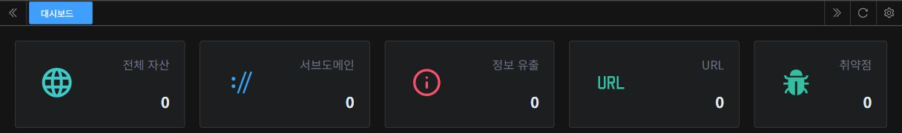
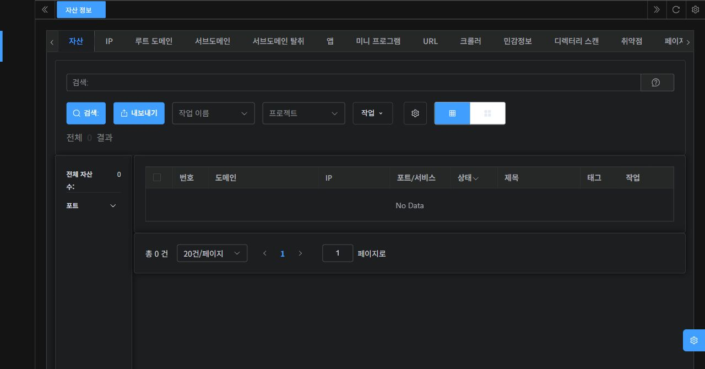
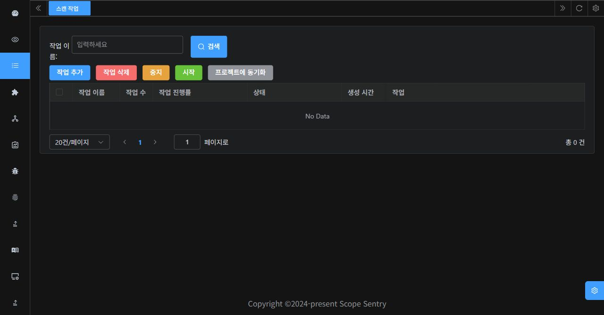
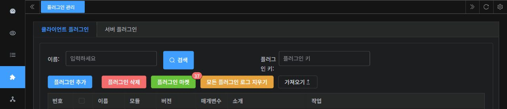
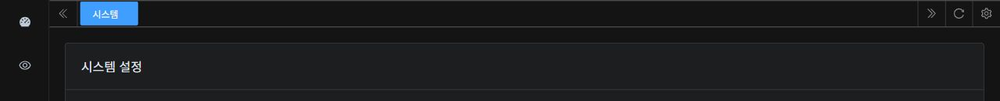

<div align="center">
  
</div>

[English](./README.md) | [中文](./README_CN.md) | 한국어

# ScopeSentry

## 프로젝트 소개

ScopeSentry는 자산 매핑과 취약점 점검을 위한 분산 보안 점검 도구다.
여러 스캔 노드를 구성하고 작업별 실행 노드를 선택할 수 있다.
관리 대상 자산의 구성 요소와 취약점을 확인하는 데 활용한다.

서버는 Go/Gin, 프런트엔드는 Vue 3·TypeScript·Vite·Element Plus·vue-i18n 기반이다.
데이터 저장소로 MongoDB, 캐시로 Redis를 사용한다.

## 주요 기능

- 플러그인 기반 도구 확장
- 서브도메인 탐색 및 탈취 탐지
- 포트 스캔, 자산 식별, 사용자 지정 웹 기술 식별 규칙
- 디렉터리 스캔 및 취약점 스캔
- 민감정보 유출 탐지
- URL 추출, 웹 크롤링, 페이지 변경 모니터링
- POC 가져오기, 자산 그룹화, 프로젝트별 자산 조회
- 다중 노드 분산 스캔 및 Webhook 알림

위 목록은 공식 README에 소개된 기능이다. 세부 지원 범위는 사용 중인 버전과
플러그인 설정에 따른다. 원문의 기능·구현 설명 차이는 [개발·검증 기록](./frontend/LOCALIZATION.md) 참고.

## 설치

Git, Docker, Docker Compose가 필요하다. 공식 README의 단일 호스트 설치 절차:

```sh
git clone https://github.com/Autumn-27/ScopeSentry.git
cd ScopeSentry
# .env에서 MongoDB·Redis 계정과 비밀번호 설정
docker-compose -f single-host-deployment.yml up -d
```

Compose v2에서는 `docker-compose` 대신 `docker compose` 사용.
기본 구성은 MongoDB, Redis, 서버 `scope-sentry`, 스캔 노드 `scopesentry-scan`의
네 컨테이너이며 서버 포트는 `8082`. 스캔 노드 하나 포함.

초기 로그인 비밀번호와 플러그인 보조 인증정보 확인:

```sh
docker logs scope-sentry
```

실제 비밀번호, API Key, 환경 파일은 공유 로그나 PR에 포함하지 않음.

### 스캔 노드 추가

```sh
git clone https://github.com/Autumn-27/ScopeSentry-Scan.git
cd ScopeSentry-Scan/build
# .env에서 MongoDB·Redis 연결 정보 설정
# NodeName은 노드마다 다르게 지정
docker-compose -f scan-docker-compose.yml up -d
```

NodeName을 비워 두면 이름이 자동 생성되며 웹 화면에서 변경 가능.
설정 파일 경로와 세부 절차는 해당 스캔 노드 버전의 문서 참고.

## 한국어 UI 설정

한국어 UI가 포함된 소스 빌드에서 상단 언어 메뉴의 `한국어` 선택.
지원 언어는 `简体中文`, `English`, `한국어(ko-KR)`이며 선택값은 브라우저에 저장된다.

언어 변경 확인창에서 취소하면 현재 입력 유지. 승인하면 저장하지 않은 입력과
화면 상태가 초기화될 수 있음. 이미 전송한 요청은 계속 처리될 수 있으므로
저장·작업 생성이 끝난 뒤 언어 변경 권장.

한국어 지원 여부는 배포 버전에 따라 다르다. 저장소를 clone해도 기존 이미지의
UI는 바뀌지 않으므로 해당 변경을 포함한 소스 빌드와 서버 이미지 반영이 필요하다.
[빌드·검증 기록](./frontend/LOCALIZATION.md) 참고.

## 한국어 UI 화면

기존 백엔드에 로그인한 뒤 조회한 실제 화면의 부분 캡처다. 계정 식별자와 운영 데이터는 제외했다.
전체 기능·번역 검증을 의미하지 않으며, 미번역 메시지와 레이아웃 제한은 [연동 검증 기록](./docs/korean-localization/integration-evidence.md) 참고.

| 대시보드 집계 | 자산 검색·빈 목록 |
|---|---|
|  |  |

| 스캔 작업 목록 | 플러그인 검색·헤더 |
|---|---|
|  |  |

시스템 설정은 실제 설정값을 제외한 제목 영역만 공개한다.



## 기본 사용법

1. `http://<서버>:8082`에 접속해 로그인. 리버스 프록시 환경은 실제 공개 URL 사용.
2. 프로젝트의 관리 범위와 사용할 스캔 노드·템플릿·플러그인 확인.
3. 점검 권한이 있는 대상을 입력하고 스캔 작업 구성.
4. 자산 정보와 작업 목록에서 결과 조회.
5. 필요에 따라 기술 식별·POC·민감정보 규칙 및 시스템 설정 관리.

백엔드 응답 메시지, 플러그인 이름·소개, 로그 원문은 기존 언어로 표시될 수 있음.
기능별 사용 화면은 [영어 README](./README.md#screenshots)와
[중국어 README](./README_CN.md) 참고.

## MCP 연결

공식 [MCP 안내](./SKILL.md) 기준으로 `/mcp`의 Streamable HTTP와 API Key 인증 사용.
배포 인스턴스의 지원 여부와 공개 경로는 해당 버전·프록시 설정 확인 필요.

1. API Key 관리 화면에서 키 생성. 키는 한 번만 표시되므로 복사해 보관.
2. MCP 클라이언트에 서버 URL과 인증 헤더 등록. Cursor 설정 예시:

```json
{
  "mcpServers": {
    "scopesentry": {
      "url": "http://<SERVER_HOST>:8082/mcp",
      "headers": {
        "X-API-Key": "<YOUR_SCOPESENTRY_API_KEY>"
      }
    }
  }
}
```

3. `<SERVER_HOST>`와 `<YOUR_SCOPESENTRY_API_KEY>`를 실제 값으로 교체한 뒤 연결 다시 로드.
4. `list_projects`, `list_assets`, `list_tasks`, `list_nodes` 등 도구 목록 확인.

`Authorization: Bearer <YOUR_SCOPESENTRY_API_KEY>` 방식도 지원.
프로젝트 필터에는 표시 이름이 아닌 ObjectID, 스캔 템플릿에는 템플릿 ID 사용.
도구별 매개변수와 추가 예시는 [공식 MCP 문서](./SKILL.md) 참고.
문서의 키는 자리표시자이며 실제 키를 저장하지 않음.

## 라이선스

공식 README는 모든 브랜치에 AGPL-3.0과 다음 추가 조건을 명시한다.

1. 상업적 이용에는 별도의 상업용 라이선스 필요.
2. 회사·조직·영리 단체는 사용·배포·수정 전에 상업용 라이선스 취득 필요.
3. 개인과 비영리 조직은 AGPL-3.0 조건에 따라 사용 가능.
4. 상업용 라이선스 문의: `rainy-autumn@outlook.com`.

프런트엔드에는 별도의 [MIT LICENSE](./frontend/LICENSE)와 Archer 저작권 고지가 있다.
기존 고지는 유지했으며, 이 번역은 새로운 이용 권한을 부여하지 않는다.
고지 간 적용 관계는 유지보수자에게 확인이 필요하다.

## 공식 참고 문서

- [영어 README](./README.md) · [중국어 README](./README_CN.md) · [MCP 안내](./SKILL.md)
- [공식 웹사이트·설치 문서](https://www.scope-sentry.top/)
- [서버 저장소](https://github.com/Autumn-27/ScopeSentry)
- [스캔 노드 소스](https://github.com/Autumn-27/ScopeSentry-Scan)
- [프런트엔드 소스](https://github.com/Autumn-27/ScopeSentry-UI)
- [플러그인 마켓](https://plugin.scope-sentry.top/)
- [플러그인 템플릿](https://github.com/Autumn-27/ScopeSentry-Plugin-Template)
- [분산 구성 참고 글](https://mp.weixin.qq.com/s/xfgRxUjljoQ8KzacblktxA)
- [Discord 안내](https://discord.gg/GWVwSBBm48) — 후원·협업 등 다른 연락 방법은 중국어 README 참고
