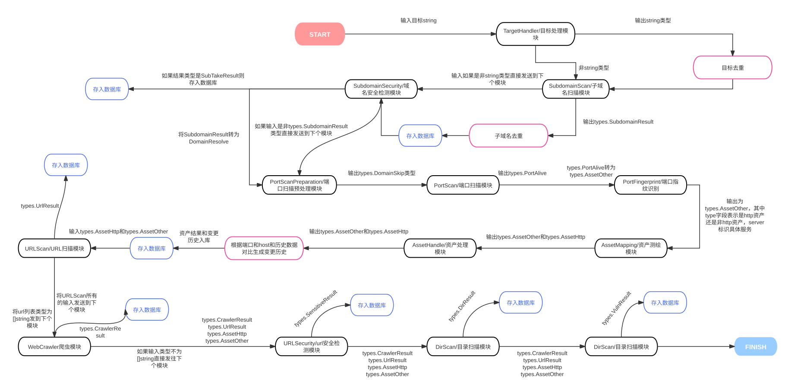

<div align="center">
  
</div>

[English](./README.md) | [中文](./README_CN.md) | 한국어

# ScopeSentry

## 프로젝트 소개

ScopeSentry는 자산 매핑, 서브도메인 탐색, 정보 유출 탐지, 취약점 스캔,
디렉터리 스캔, 서브도메인 탈취 탐지, 크롤링, 페이지 모니터링 기능을 제공하는
분산 보안 점검 도구입니다. 여러 스캔 노드를 구성하고 작업을 수행할 노드를
선택할 수 있습니다. 새로운 취약점이 공개되면 관리 대상 자산에 관련 구성
요소가 있는지 확인하는 데 활용할 수 있습니다.

이 문서는 공식 [영어 README](./README.md), [중국어 README](./README_CN.md),
[MCP 안내](./SKILL.md)와 현재 소스 구조를 바탕으로 작성했습니다. 아래 기능
목록은 원문에 소개된 기능이며, 이 한국어화 PR에서 모두 실행 검증했다는 뜻은 아닙니다.

## 주요 기능

- 도구를 확장해 추가할 수 있는 플러그인 시스템
- 서브도메인 탐색 및 탈취 탐지
- 포트 스캔, 자산 식별, 사용자 지정 웹 기술 식별 규칙
- 디렉터리 스캔 및 취약점 스캔
- 민감정보 유출 탐지
- URL 추출, 웹 크롤러, 페이지 변경 모니터링
- POC 가져오기, 자산 그룹화, 프로젝트별 자산 조회
- 여러 노드를 이용한 분산 스캔
- Webhook 알림

중국어 README에는 ICP·앱·미니 프로그램 정보 수집, PDF 민감정보 스캔,
데이터 내보내기도 소개되어 있습니다. 세부 지원 범위는 해당 버전의 원문과
플러그인 설정을 확인하세요. 약한 비밀번호 대입과 관계도는 원문에서 예정
항목으로 분류되어 있으며, 여기서 완료된 기능으로 안내하지 않습니다.

## 구성과 관련 프로젝트

현재 저장소 소스의 서버는 **Go / Gin**, 프런트엔드는 **Vue 3 / TypeScript /
Vite / Element Plus / vue-i18n** 기반입니다. 데이터 저장과 캐시에 MongoDB와
Redis를 사용하며 스캔 노드는 별도 프로젝트로 제공됩니다.

> 영어·중국어 README의 서버 `python - FastApi` 표기는 현재 Go 소스와 다릅니다.
> 원문은 그대로 두었으며, 유지보수자 검토 사항으로 기록했습니다.

- [공식 웹사이트·설치 문서](https://www.scope-sentry.top/)
- [ScopeSentry 서버 저장소](https://github.com/Autumn-27/ScopeSentry)
- [스캔 노드 소스](https://github.com/Autumn-27/ScopeSentry-Scan)
- [프런트엔드 소스](https://github.com/Autumn-27/ScopeSentry-UI)
- [플러그인 마켓](https://plugin.scope-sentry.top/)
- [플러그인 템플릿](https://github.com/Autumn-27/ScopeSentry-Plugin-Template)
- [분산 구성 참고 글](https://mp.weixin.qq.com/s/xfgRxUjljoQ8KzacblktxA)

## 설치

다음은 공식 README에 안내된 단일 호스트 Docker Compose 설치 절차입니다.
Git, Docker 및 Docker Compose를 준비한 별도의 설치 환경에서 실행합니다.
이번 PR 검증에서는 컨테이너 설치나 운영 배포를 실행하지 않았습니다.

```sh
git clone https://github.com/Autumn-27/ScopeSentry.git
cd ScopeSentry
# 실행 전 .env에서 MongoDB와 Redis 계정·비밀번호를 설정합니다.
docker-compose -f single-host-deployment.yml up -d
```

원문은 `docker-compose` 명령을 사용합니다. Compose v2 환경에서는 설치된
명령 형식에 맞춰 `docker compose -f single-host-deployment.yml up -d`를 사용합니다.
현재 Compose 파일은 MongoDB, Redis, 서버 `scope-sentry`, 스캔 노드
`scopesentry-scan`의 네 컨테이너를 구성하고 서버 포트 `8082`를 게시합니다.
기본 구성에는 스캔 노드 하나가 포함됩니다.

서버의 초기 로그인 비밀번호와 플러그인 보조 인증정보 확인 방법은 원문과 같습니다.

```sh
docker logs scope-sentry
```

확인한 실제 비밀번호·API Key·환경 파일을 PR이나 공유 로그에 포함하지 마세요.

### 스캔 노드 추가 — 선택 사항

```sh
git clone https://github.com/Autumn-27/ScopeSentry-Scan.git
cd ScopeSentry-Scan/build
# .env에서 MongoDB·Redis 연결 정보를 설정합니다.
# 각 노드의 NodeName은 서로 다르게 지정합니다.
docker-compose -f scan-docker-compose.yml up -d
```

원문에 따르면 NodeName을 비워 두면 이름이 자동 생성되고 웹 화면에서 변경할 수 있습니다.
스캔 노드 파일 경로와 설정은 설치하려는 스캔 노드 버전의 문서를 확인하세요.
이 추가 노드 절차는 이번 한국어화 검증에서 실행하지 않았습니다.

### 한국어 UI 소스의 빌드

이 변경안은 `简体中文`, `English`, `한국어(ko-KR)` 선택을 지원합니다.
**기존에 배포된 v1.9.4 또는 `latest` 이미지에 이 PR의 한국어 변경이 이미
포함되어 있다는 뜻은 아닙니다.** Compose의 기존 이미지를 실행하거나 저장소를
clone하는 것만으로 기존 이미지 안의 UI가 교체되지는 않습니다.

프런트엔드 검증 명령은 다음과 같습니다.

```sh
cd frontend
npm ci --ignore-scripts
node scripts/check-locales.mjs
node scripts/check-locale-stability.cjs
npx vite build --mode pro
```

결과는 `frontend/dist-pro`에 생성됩니다. 현재 release workflow는 이 결과를
`cmd/main/static`에 병합한 뒤 서버 바이너리에 포함합니다. 새 서버 이미지의
빌드·배포와 기존 데이터 보존은 해당 배포 절차에 따라 별도로 수행해야 합니다.
프런트엔드 build 통과는 서버 이미지의 빌드·배포 검증을 뜻하지 않습니다.

## 사용법

1. 설치 환경의 `http://<서버>:8082`에 접속해 로그인합니다. 프록시를 사용하면
   실제 공개 URL에 맞춥니다.
2. 상단 언어 메뉴에서 `한국어`를 선택합니다. 선택값은 브라우저 로컬 저장소에 보관됩니다.
3. 프로젝트에서 관리할 범위를 설정하고 스캔 템플릿·플러그인과 사용 가능한 노드를 확인합니다.
4. 권한이 있는 대상에 대해 스캔 작업을 구성합니다. 대상과 노드·템플릿·모듈 설정은
   해당 화면 및 원문 문서를 기준으로 확인합니다.
5. 자산 정보와 작업 목록에서 결과를 조회하고, 필요한 경우 기술 식별·POC·민감정보
   규칙과 시스템 설정을 관리합니다.

언어를 바꾸면 현재 콘텐츠가 다시 생성됩니다. 확인창에서 **취소하면 입력이
유지**되고, **승인하면 미저장 폼과 화면 상태가 초기화될 수 있습니다.** 이미
전송한 요청은 계속 처리될 수 있으므로 저장·작업 생성이 끝난 뒤 전환하세요.
백엔드 응답 메시지, 플러그인 이름·소개, 로그 원문은 기존 언어로 표시될 수 있습니다.

위 순서는 소스와 원문을 바탕으로 한 사용 흐름입니다. 이번 검증은 로그인
화면과 언어 전환에 한정되며, 인증 후 스캔·관리 기능의 실행 검증을 뜻하지 않습니다.

## MCP 연결

공식 [MCP 안내](./SKILL.md)와 현재 `internal/mcp` 구현은 `/mcp`에서
Streamable HTTP 연결 및 API Key 인증을 제공합니다. 기존에 배포된 인스턴스가
해당 기능을 제공하는지는 사용 중인 버전과 배포 구성을 확인해야 합니다.
이번 PR에서는 MCP 연결이나 도구 실행을 실제 서버에 대해 검증하지 않았습니다.

1. API Key 관리 화면에서 키를 생성합니다. 키는 한 번만 표시되므로 복사하여 보관합니다.
2. MCP 클라이언트에 서버 URL과 인증 헤더를 등록합니다. 다음은 공식 안내의
   Cursor 설정 형식을 한국어 설명으로 옮긴 예시입니다.

```json
{
  "mcpServers": {
    "scopesentry": {
      "url": "http://<SERVER_HOST>:8082/mcp",
      "headers": {
        "X-API-Key": "<YOUR_SCOPESENTRY_API_KEY>"
      }
    }
  }
}
```

`<SERVER_HOST>`와 `<YOUR_SCOPESENTRY_API_KEY>`는 예시 자리표시자입니다.
실제 키를 문서에 저장하지 마세요. 원문과 서버 middleware는
`Authorization: Bearer <YOUR_SCOPESENTRY_API_KEY>` 방식도 안내합니다.
리버스 프록시가 있으면 URL과 경로를 실제 구성에 맞춥니다.

3. 클라이언트에서 연결을 다시 로드하고 `list_projects`, `list_assets`,
   `list_tasks`, `list_nodes` 등의 도구가 표시되는지 확인합니다.

추가 매개변수와 도구 목록은 [공식 MCP 문서](./SKILL.md)를 기준으로 확인하세요.
프로젝트 필터에는 표시 이름이 아닌 ObjectID를, 스캔 템플릿에는 템플릿 ID를
사용합니다. MCP 도구의 실제 실행은 이번 UI 번역 작업의 범위에 포함되지 않습니다.

## 플러그인 흐름



## 한국어 화면 및 검증 범위

로컬 로그인 화면에서 한국어 표시와 중국어·영어·한국어 전환을 확인했습니다.

세 언어의 번역 키 857개, 보간 변수와 영어 fallback 검사 및 production build를
확인했습니다. 전체 TypeScript 검사는 원본과 동일한 기존 오류 151개로 실패하며
새 진단은 없습니다. 인증 후 화면, 실제 로그인·로그아웃, API·스캔 기능과 MCP
연동은 이번 PR에서 검증하지 않았습니다.

전후 비교 캡처와 상세 검사 로그는 PR 검토 자료로 별도 보관합니다. 기존 공식 스크린샷은
[영어 README](./README.md#screenshots)와 [중국어 README](./README_CN.md)에서 볼 수 있습니다.
원문의 이미지를 이번 작업의 인증 후 검증 결과로 재사용하지 않았습니다.

## 라이선스와 저작권

공식 README는 프로젝트의 모든 브랜치에 **AGPL-3.0** 및 다음 추가 조건을 명시합니다.

1. 상업적 이용에는 별도의 상업용 라이선스가 필요합니다.
2. 회사·조직·영리 단체는 사용·배포·수정 전에 상업용 라이선스를 받아야 합니다.
3. 개인과 비영리 조직은 AGPL-3.0 조건에 따라 사용할 수 있습니다.
4. 상업용 라이선스 문의: `rainy-autumn@outlook.com`.

이 안내는 원문 고지를 한국어로 옮긴 것이며 새로운 이용 권한을 부여하지 않습니다.
프런트엔드에는 별도의 [MIT LICENSE](./frontend/LICENSE)와 Archer 저작권 고지가
있습니다. 기존 파일·고지는 유지했습니다. 루트 고지와 프런트엔드 고지의 적용
관계는 유지보수자의 안내를 확인하세요.

## 커뮤니티

- [공식 Discord 안내](https://discord.gg/GWVwSBBm48)
- 후원·협업 및 다른 연락 방법은 [중국어 README](./README_CN.md)를 참고하세요.
