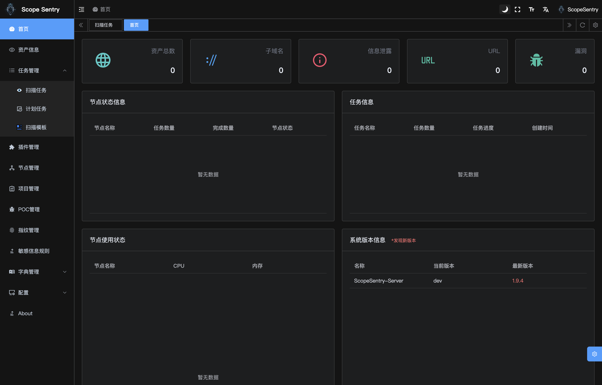
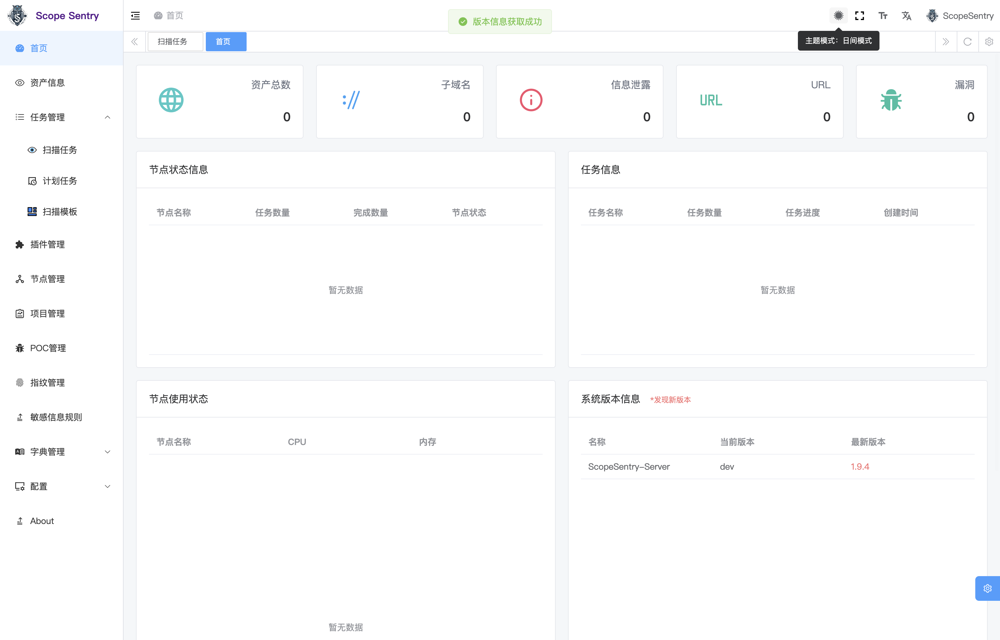
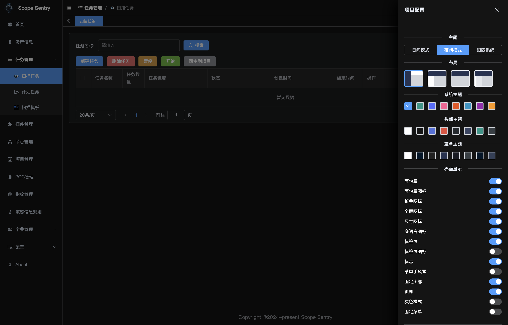

# 界面主题：日间 / 夜间 / 跟随系统

ScopeSentry 前端支持三态主题，默认 **跟随系统（设备）**。

| 模式 | 行为 | 持久化值 |
| --- | --- | --- |
| 跟随系统 `auto`（默认） | 读取操作系统/浏览器的 `prefers-color-scheme`，系统切换深浅色时页面实时跟随 | `themeMode = "auto"` |
| 日间 `light` | 固定浅色，不跟随系统 | `themeMode = "light"` |
| 夜间 `dark` | 固定深色，不跟随系统 | `themeMode = "dark"` |

## 切换入口

- 顶栏右上角：太阳/月亮/显示器图标下拉，三项「日间模式 / 夜间模式 / 跟随系统」，当前项带勾选。
- 登录页右上角：同一个控件，未登录也能切换。
- 右下角「项目配置」抽屉 → 主题。

三处共用一个组件 `src/components/ThemeSwitch/src/ThemeSwitch.vue`，状态统一在 `src/store/modules/app.ts`。

## 实现要点

1. **状态与持久化**（`store/modules/app.ts`）
   - `themeMode`（`auto | light | dark`，默认 `auto`）+ `systemDark`（`prefers-color-scheme` 的当前值）。
   - `setThemeMode(mode)` 写入 localStorage 键 `themeMode`，并立即应用。
   - `setSystemDark(dark)` 只在 `auto` 模式下实时应用，手动指定的日间/夜间不会被系统切换覆盖。
   - `initTheme()` 在 `App.vue` setup 阶段调用：读取持久化 `themeMode`（缺失/非法 → `auto`）→ 绑定 `matchMedia('(prefers-color-scheme: dark)')` 监听（先解绑再绑定，兼容旧 Safari 的 `addListener`；SSR 无 `window` 时直接返回）。
   - **旧版 `isDark` 不做迁移**：旧代码每次启动都按系统状态覆写它，无法区分「用户显式选择」和「系统当时是深色」，迁移会把升级用户永久钉在浅色/深色。它只作为兼容写回，不参与决策。
   - `getStorage` 对 `localStorage` 被禁用、写入损坏做了 try/catch，读失败按「没有」处理，不会让根组件 setup 抛错白屏。
2. **首屏防闪烁**（`index.html`）
   - `<head>` 内联脚本在样式/JS 加载前就根据 `themeMode`（兼容旧键 `isDark`）给 `<html>` 加 `dark`/`light` 类并设置 `color-scheme`，避免先白后黑的闪屏；加载动画本身也有深色样式。
   - 内联脚本能解析 `useStorage` 写入的 `{"type":"String","value":"auto"}` 包装格式，也能解析裸字符串/布尔值。
3. **样式来源**
   - Element Plus 官方深色变量：`element-plus/theme-chalk/dark/css-vars.css`（已在 `styles/index.less` 引入）。
   - UnoCSS 的 `dark:` 变体按 class 策略生效（`uno.config.ts` 中 `presetUno({ dark: 'class' })`），现有布局、标签页、内容区都已使用。
   - `styles/dark.less` 是补丁层：只收口历史页面里写死的浅色面（扫描模板卡片、资产详情悬浮面板、关于页等），避免影响 Element Plus 自身配色。
4. **图表**（`components/Echart/src/Echart.vue`）
   - ECharts 主题只能在 `init` 时指定，因此监听 `isDark`：切换时 `dispose()` 后以 `dark` 主题重建实例，保证坐标轴、图例、tooltip 同步换色。
5. **可访问性/原生控件**
   - 同步设置 `document.documentElement.style.colorScheme`，滚动条、表单原生控件、`<input type="date">` 等跟随主题。

## 新增页面约定

- 颜色优先用 Element Plus 变量：`var(--el-bg-color)`、`var(--el-bg-color-overlay)`、`var(--el-text-color-primary)`、`var(--el-border-color)`、`var(--el-fill-color-light)`。
- 需要按主题分叉时用 UnoCSS：`bg-[var(--app-content-bg-color)] dark:bg-[var(--el-bg-color)]`。
- 不要写死 `#fff` / `#ffffff` / `#f5f7fa` 作为大面积背景；确实无法抽象时加进 `styles/dark.less` 并写清来源页面。

## 验证

```bash
cd frontend
node scripts/check-locales.mjs   # 三种语言 863 个叶子键一致（含 themeMode/themeAuto/themeLight/themeDark）
npx vue-tsc --noEmit --skipLibCheck
npx vite build --mode pro        # 产物 dist-pro/
```

实际验证记录（本地真实前后端，Chromium 无头浏览器截图）：

| 场景 | 结果 |
| --- | --- |
| 首次访问，系统为深色 | `<html class="dark">`，themeMode=auto（默认跟随） |
| 手动切日间后真实刷新，系统仍为深色 | 保持 `light`，header 白底，systemDark=true —— 手动选择优先于系统 |
| localStorage 只有旧版 `isDark=false` | 按设计忽略该值，themeMode 回到 `auto`（跟随系统） |
| 切回「跟随系统」 | 立即恢复为系统深色 `dark` |
| `pnpm theme:check` | 30+ 断言全部 PASS（模式校验、迁移、首屏脚本、UI 三选项接线） |

截图：深色 、浅色 。

手动验证清单：

1. 清空 localStorage 首次进入 → 默认跟随系统；把系统切到深色，页面无需刷新即变深。
2. 顶栏切到「夜间模式」→ 刷新后仍是夜间；此时再切系统主题，页面不跟随。
3. 切到「日间模式」→ 刷新后仍是日间。
4. 切回「跟随系统」→ 立即对齐系统当前状态。
5. 登录页切换 → 登录后进入后台保持一致。
6. 图表页（首页 Dashboard / 项目详情）在两种模式下坐标轴与图例清晰可读。

## UI/UX 细节（本次一并打磨）

| 细节 | 行为 | 实现位置 |
| --- | --- | --- |
| 切换过渡 | 手动切换主题时整页 240ms 颜色过渡（背景/文字/边框/阴影），300ms 后移除过渡类；`prefers-reduced-motion` 下不启用 | `store/modules/app.ts::playThemeTransition` + `styles/index.less` |
| 首屏一致性 | `<meta name="color-scheme" content="light dark">` + 内联脚本，浏览器原生控件/滚动条在 JS 执行前就按主题渲染 | `index.html` |
| 滚动条 | 8px、跟随 `--el-border-color-darker`，hover 加深；Firefox 用 `scrollbar-width/color` | `styles/index.less` |
| 键盘可达性 | 主题入口是真 `<button>`，带动态 `aria-label`（如「主题模式：夜间模式」）；`:focus-visible` 主色描边 | `ThemeSwitch.vue` + `styles/index.less` |
| 顶栏图标 | `.custom-hover` 统一 hover 底色（仅顶栏内），其余图标不再"点了没反馈" | `styles/index.less` |
| 设置面板 | 主题从下拉改为三段式分段控件（日间 / 夜间 / 跟随系统），一眼看清当前值 | `components/Setting/src/Setting.vue` |
| 编辑器 | Monaco（指纹/差异视图）在 `vs` 与 `vs-dark` 间切换；CodeMirror（POC）深色挂 oneDark、浅色用默认亮色，并移除写死的 `#1e1e1e` 覆盖 | `MonacoDiffEditor.vue`、`Fingerprint/components/Detail.vue`、`Poc/components/Detail.vue` |
| 图表 | ECharts 切换时 dispose 后按 `dark` 主题重建，卸载时释放实例，避免 canvas/ResizeObserver 泄漏 | `components/Echart/src/Echart.vue` |
| 文案 | 主题菜单项、提示、状态标签（待开始）三语齐备，864 键对齐 | `locales/{zh-CN,en,ko-KR}.ts` |

设置面板主题分段控件：


