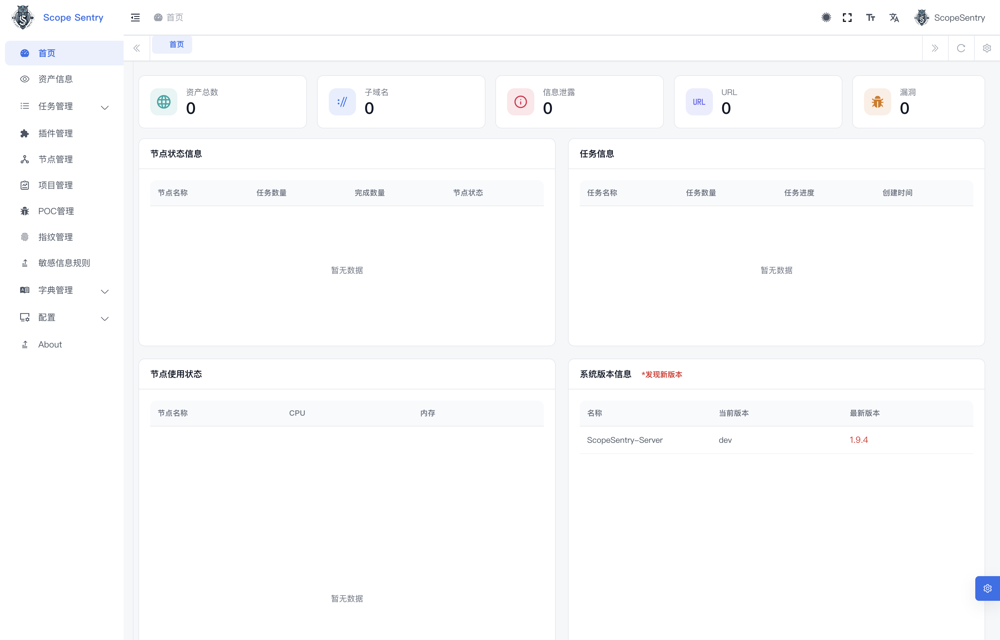
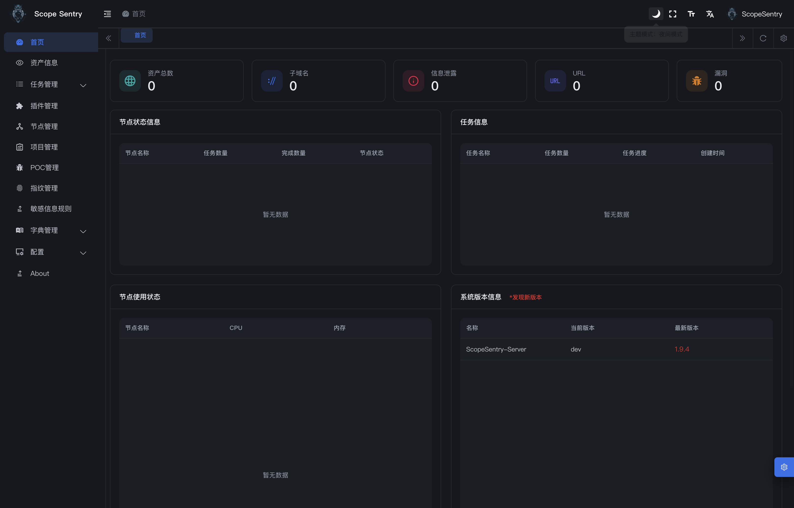
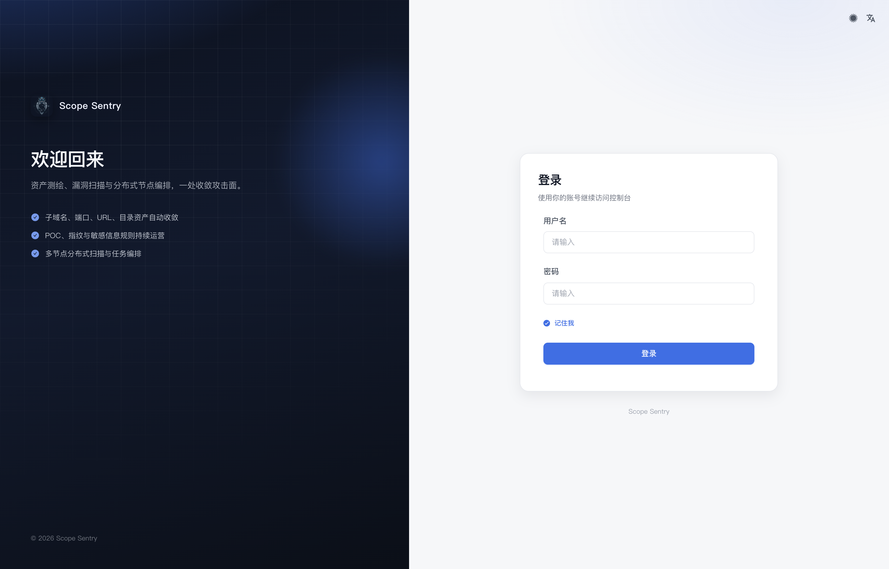
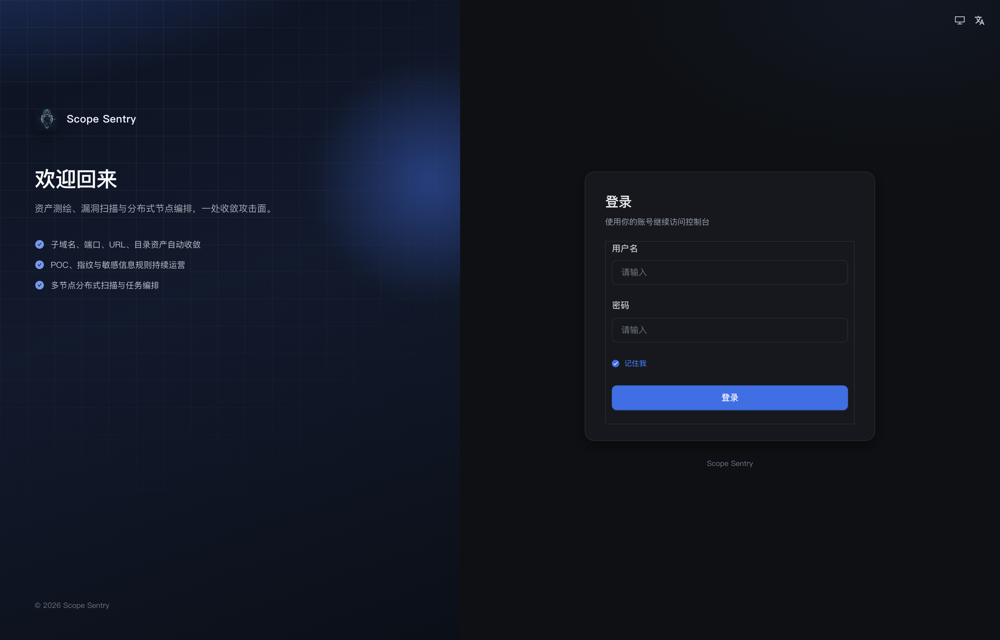
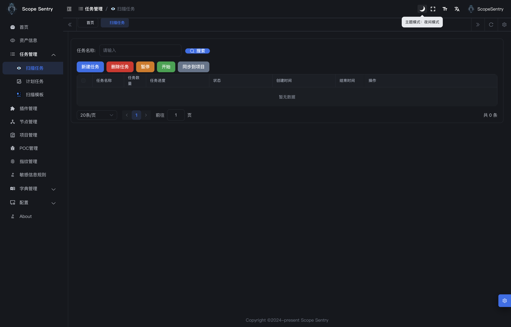
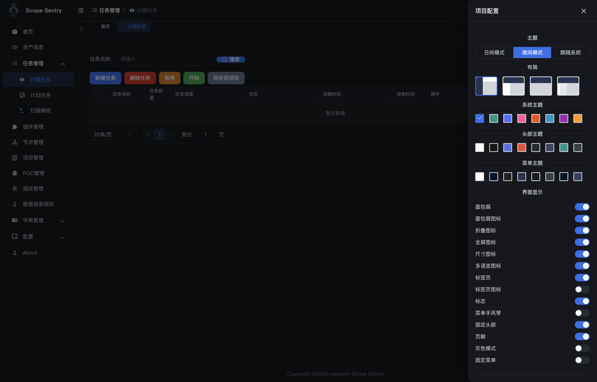
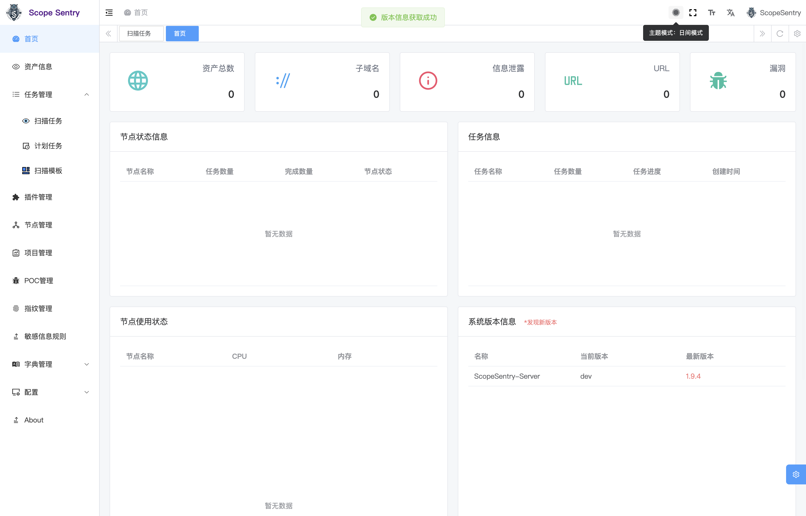
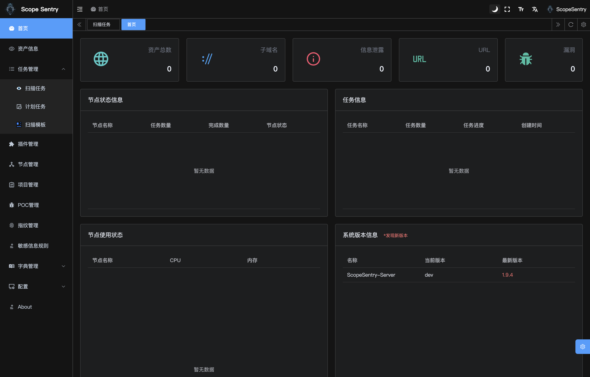

# UI/UX 现代化

目标：把默认的 `vue-element-plus-admin` 观感换成更接近 GitHub Primer / Linear 的现代后台风格 —— 中性灰面、1px 分隔、克制阴影、统一圆角、克制的品牌蓝，同时保留 Element Plus 的交互语义与既有业务布局。

## 设计语言

| 维度 | 取值 | 说明 |
| --- | --- | --- |
| 品牌色 | `#2f6feb`（hover `#2560d4`） | GitHub 蓝，替换原 `#409eff`；浅色梯度 light-3/5/7/8/9 一并重算 |
| 语义色 | 绿 `#16a34a` / 橙 `#d97706` / 红 `#dc2626` / 灰 `#64748b` | 只用于状态，不做装饰 |
| 画布 | 浅 `#f6f7f9` / 深 `#0e1013` | 与卡片形成层次 |
| 面板 | 浅 `#ffffff` / 深 `#15181d` | 卡片、侧边栏、弹层 |
| 分隔 | 浅 `#e5e8ee` / 深 `#262b33` | 1px 线，不用重阴影分隔 |
| 圆角 | 6 / 8 / 10 / 14px | 标签与输入框 8、卡片 10、弹窗 14 |
| 阴影 | xs → lg（黑 8%~12%） | 卡片默认无阴影，hover 才抬升 |
| 字体 | 系统栈（SF / Segoe UI / Inter / PingFang SC） | 表格数字 `tabular-nums` 对齐 |
| 尺寸 | 顶栏 56、标签页 42、内容 padding 24 | 比原版更松一点 |

## 改了什么

- **外壳**：顶栏 56px + 1px 下边框；侧边栏改为白色/深色面板 + 右侧 1px 线；菜单项 40px 圆角 8px，选中态是 `primary@10%` 的 pill（不是整块主色）；折叠态图标居中。
- **标签页**：从“主色实心方块”改为 pill：28px 高、圆角 6px、选中态 `primary@10%` + 主色文字。
- **卡片**：10px 圆角 + 1px 边框 + 无默认阴影；header 18px 内边距、600 字重。
- **表格**：表头 12px 次级色 + `#f8fafc`/`#1b1f26` 底色、行高 42px、行 hover、无外侧阴影；31 处视图里写死的表头色统一换成 `--app-surface-2`。
- **按钮**：34px 高、圆角 8px、500 字重；主按钮带 1px 蓝阴影；small 28px。
- **输入**：34px 高、圆角 8px、`box-shadow` 描边，focus 时主色描边 + 3px 光晕。
- **弹层**：Dialog 14px 圆角、Drawer 左侧 14px 圆角、Dropdown/Popper 圆角 + 细边框；Message/Notification 同构。
- **登录页**：重做为左右分栏 —— 左侧深色渐变品牌墙（网格 + 光晕 + 特性列表），右侧 404px 卡片；标题/副标题从表单内移到卡片头部，表单只留字段与按钮。
- **首页指标卡**：改为“色块图标 + 标签 + 26px 数字”的横向布局，5 个指标各用识别色（teal/blue/rose/indigo/amber），hover 时边框染色并轻微上浮。
- **设置抽屉**：主题仍是三段式控件，抽屉整体跟随新圆角/阴影；右下角设置按钮改成左圆角矩形 + hover 位移。

## 实现位置

| 文件 | 作用 |
| --- | --- |
| `src/styles/var.css` | 设计 token：颜色/圆角/阴影/字体/布局尺寸（浅色 + `html.dark`） |
| `src/styles/modern.less` | Element Plus 组件层重绘 + 外壳细节；所有选择器带 `html` 前缀 |
| `src/components/Menu/src/Menu.vue` | 侧边栏 pill 菜单、折叠/水平模式 |
| `src/components/TagsView/src/TagsView.vue` | 标签页 pill |
| `src/views/Login/Login.vue` | 登录页重做 |
| `src/views/Login/components/LoginForm.vue` | 去掉表单内标题、清理未用代码 |
| `src/views/Dashboard/components/PanelGroup.vue` | 指标卡重构（v-for + 颜色 token） |
| `src/layout/components/useRenderLayout.tsx` | 侧边栏底色/分隔 |
| `src/store/modules/app.ts` | 默认主色改 `#2f6feb`；标签页高度 42 |

## 为什么全局覆盖要加 `html` 前缀

Element Plus 的组件样式是按需拆分的 CSS chunk，路由进入时才加载，**加载顺序在我们的 `index.css` 之后**。同特异度下后者胜出，所以 `.el-card { border-radius: 10px }` 会被 Element 自己的 `.el-card { border-radius: 4px }` 覆盖。

解决方式：`modern.less` 里所有选择器统一加 `html` 前缀（`html .el-card` = 0-1-1 > `.el-card` = 0-1-0），变量块用 `html:root`。这样不依赖构建顺序，也不会破坏 Element 的复合状态选择器（如 `.el-button.is-disabled`）。

## 新增页面约定

- 颜色只用 token：`var(--app-surface)`、`var(--app-border)`、`var(--el-text-color-secondary)`、`var(--app-primary)`；深浅色自动适配。
- 圆角用 `var(--app-radius-sm|md|lg)`，阴影用 `var(--app-shadow-sm|md)`。
- 不要再写死 `#fff` / `#409eff` / `border-radius: 2px`；确需例外时同时给出 `html.dark` 值。
- 组件内部样式（scoped）优先直接改组件，不要在全局用 `!important` 硬压。

## 验证

```bash
cd frontend
npx vue-tsc --noEmit --skipLibCheck   # 本次改动文件 0 报错
npx vite build --mode pro             # Build successful
npx esno ./scripts/check-theme.ts     # 主题三态 48 项 ALL PASS
node scripts/check-locales.mjs        # en/zh-CN/ko-KR 869 键一致
```

浏览器实测（本地真实前后端）：登录页深/浅两套、首页指标卡、任务列表、资产列表、设置抽屉均无布局错位；深浅切换后表格/菜单/按钮/标签页同步换色。

## 截图

| | 浅色 | 深色 |
| --- | --- | --- |
| 首页 |  |  |
| 登录 |  |  |
| 任务列表 | — |  |
| 设置抽屉 | — |  |

## 改造前后

| 改造前（浅色） | 改造后（浅色） |
| --- | --- |
|  |  |

| 改造前（深色） | 改造后（深色） |
| --- | --- |
|  |  |
